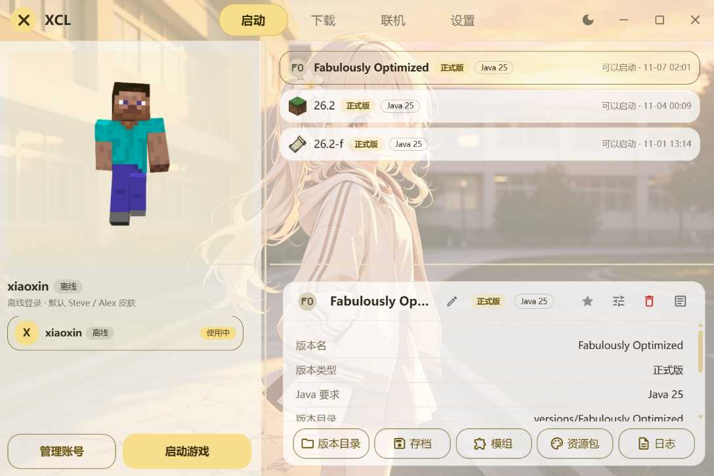
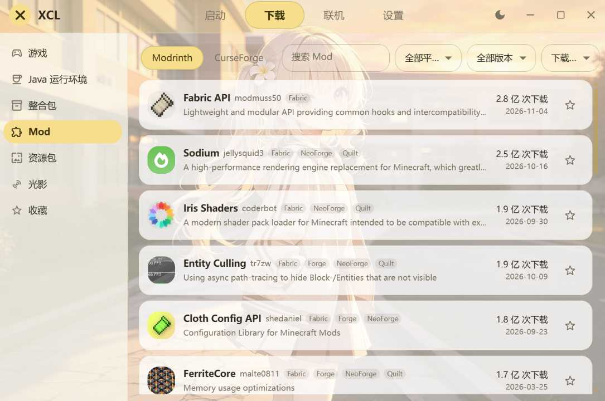

# Xin Craft Launcher（XCL）

先把启动这件事做好。

一个安静、顺手的 Minecraft 启动器。找版本、装模组、点启动，然后进游戏 —— 每天要做的就这几件事，把它做顺就够了。

所有东西都在本地：没有广告，没有付费解锁，存档和账号只属于你自己。单个 exe 双击就能跑，不需要安装；整个数据目录拷走，换台机器接着用。目前面向 Windows x64。

## 全新架构

Tauri 2 与 Rust（2024 edition，1.90 以上）跑本地能力，React 19 和 MUI 9 画界面，Vite 8 负责构建 —— 都是各自当下的主版本，整套从零搭起，不是从旧版本一路升级上来的。

## 界面

| 启动页 | Mod 下载页 |
| --- | --- |
|  |  |

## 功能

下面这些，都是已经能用的。

### 游戏版本

- 拉取官方版本清单，按正式版 / 预览版 / 远古版 / 愚人节版分类，再按大版本分组；标出发布时间、是否已安装、已装了哪个加载器。
- 安装原版，或原版 + Fabric / Forge / NeoForge 一起装成一条独立版本。安装前能预览文件数量、体积、需要的 Java 版本。
- 已装的版本可以校验并修复（只补缺失文件）、重试失败项。
- 本地版本列表显示类型、Java 要求、能否启动、上次启动时间，运行中的版本有状态点。
- 版本管理：改名、删除、收藏（列表里排最前）、换自定义图标、写版本说明；查看占用空间和 Mod / 存档 / 截图 / 资源包数量。
- 一键打开版本目录、游戏目录、存档、模组、资源包、材质包、日志。
- 版本隔离：默认每个版本各自一份存档和 mods；单个版本可以单独设为「跟随全局 / 隔离 / 不隔离」。
- 单版本启动设置：内存、JVM 参数、游戏参数、窗口大小、全屏、游戏语言、启动前命令、Java 路径，都可以只对这个版本生效，也可以随时恢复跟随全局。

### 下载引擎

- 下载源可选 Mojang 官方、BMCLAPI 镜像（默认）、自定义镜像；「下文件」和「拉版本清单」各有独立的优先策略，可选自动 / 镜像优先 / 官方优先。自动档会双源竞速。
- 可以实测下载源连通性（真拉一次清单并解析）。
- 多文件并发、单文件多连接分片；按文件的真实地址决定是否分片，服务端不支持断点或分片失败时自动退回单连接整份重下。
- 断点续传、失败自动换源、sha1 / 大小校验、已完整的文件直接跳过、先写临时文件再改名，中断不留半截文件。
- 并发任务数可自动或手填，另有全局限速、失败重试次数、单文件连接数上限。
- 进度统一在右下角悬浮球里：点开右侧抽屉看每个任务的速度、体积、剩余时间、失败文件名，可随时取消；系统任务栏图标同步显示进度。
- 缓存可分类清理（接口缓存 / 半截文件 / 皮肤），还能扫描并清理没有任何版本引用的库与资源。

### Java

- 启动时自动探测本机已装的 Java，包括常见发行版和其他启动器目录下的运行时。
- 按版本 JSON 推断需要的 Java 主版本，从探测结果里挑合适的。
- 没有合适的就自动下载 Mojang 官方运行时（Java 8 / 16 / 17 / 21 / 25），装完接着启动，不需要再点一次。
- 下载页可以手动下载或删除运行时，会提示本机是否已有同主版本 Java，避免重复下载。
- 设置里可以手动指定 java 可执行文件、关闭自动下载、重新扫描本机 Java。

### 启动游戏

- 一键启动 / 结束游戏，自动拼参数、解压 natives、注入账号信息。
- 内存分配可自动（按该版本 Mod 数和当前可用内存估算）或手动指定；设置页有一根实时内存占用条。
- 可配窗口大小、全屏、游戏语言、高性能显卡、启动前命令（可选等它跑完）、进程优先级、启动前清内存、自定义 JVM 与游戏参数。
- 实时游戏日志：错误行高亮，显示行数与错误数，可清空；往上翻看历史时不会被强行拽回底部。

### 账号与皮肤

- 离线账号：填一个玩家名即可，UUID 由名字派生，换启动器存档不丢；可选默认皮肤 Steve / Alex。
- 第三方账号：填认证服务器 API 地址 + 邮箱 + 密码，走 Yggdrasil / authlib-injector；一个账号下有多个角色时会让选一个；可勾选记住密码，之后一键刷新登录。
- 左栏账号列表可一键切换，右栏 3D 皮肤预览可拖拽旋转、带行走动画；皮肤拉取失败会回落到内置默认皮肤。
- 账号可删除、刷新登录；账号信息与偏好设置分开存放。
- 目前不支持微软登录。

### 资源下载

- 四类资源：Mod、整合包、资源包、光影，各自独立分类。
- 源可在 Modrinth / CurseForge 之间切换；支持关键词搜索、平台筛选（Fabric / Forge / NeoForge / Quilt）、游戏版本筛选、按相关度 / 下载量 / 最近更新排序，滚到底自动加载下一页。
- 项目详情有简介、截图、外链、分类、客户端 / 服务端支持情况。
- 安装时可以自动匹配本地版本，也可以手动挑文件版本；会列出依赖并标出必装 / 可选 / 不兼容，缺的依赖能直接跳过去装。
- 文件装到对应版本的 mods / resourcepacks / shaderpacks，也可以自选文件夹。
- 整合包支持 Modrinth `.mrpack` 和 CurseForge 格式，装完生成一条新版本并自动回到启动页。
- 列表右侧星标可收藏，收藏页离线可看、可搜标题和作者。

### 联机

- 不需要管理员权限，也不创建虚拟网卡。
- 房主：填房间名和房间密码 → 创建房间 → 进游戏按 Esc 点「对局域网开放」→ 端口自动扫描或手填 → 复制邀请码发给好友。
- 加入方：把整条邀请码粘进来 → 加入房间 → 等状态变成已连接 → 复制进服地址，粘到游戏「多人游戏 → 直接连接」里。其余都不用填。
- 房间页面显示人数、延迟、当前阶段、设备列表（本机 / 房主 / 成员 / 联机服务器），并标出哪些走中继；只有真正直连上才算已连接。
- 房主改端口会实时重编邀请码；退出房间有二次确认；联机日志可查看和复制。
- 首次开房会提示一次：离线账号进在线验证的世界会失败，需要改用第三方登录或让房主装离线联机相关 Mod。

### 界面

- 四个页签：启动、下载、联机（可隐藏）、设置。下载页下分游戏 / Java 运行环境 / 整合包 / Mod / 资源包 / 光影 / 收藏。
- 自绘标题栏：整条可拖动，双击最大化，带最小化 / 最大化 / 关闭和一键切换深浅色。
- 启动页左右、上下分栏都能拖，双击分隔线复位；窗口八向边缘可拉伸。
- 主题跟随系统 / 浅色 / 深色；五种预设强调色加自定义取色；背景图可配蒙版与模糊；界面不透明度与毛玻璃强度可调。
- 动画强度可选跟随系统 / 全部开启 / 全部关闭。
- 起始页、窗口大小与位置记忆；关闭窗口可以后台运行（托盘图标唤回）或直接退出。
- 右上角提示可手动关闭、悬停暂停倒计时、向右拖拽甩掉。

### 设置与维护

- 全局设置分八类：启动、界面、个性化、下载、Java、高级、更新、关于。改动即时保存，数字和文本框在失焦或回车时提交。
- 设置可导出成 TOML 文件、整份导入、恢复默认；恢复默认只重置设置，不动账号、版本和收藏。
- 高级里能打开数据目录与缓存目录、分类清理缓存、扫描并清理未使用资源、调整日志级别、复制环境信息、立即清理内存。
- 数据根优先取 `XCL_HOME`，其次 exe 同级 `data/`（可写时），再回落 `%APPDATA%\XCL`；可再生缓存固定在 `%LOCALAPPDATA%\XCL\cache`，不跟数据目录走。

### 自动更新

- 便携版自更新：更新物就是一个新的 exe，清单验签、压缩包和 exe 双重 SHA-256 校验，替换时只动程序文件，不碰 `data/`。
- 启动时可自动检查更新，也能手动检查；频道分稳定版和预览版。
- 弹窗里能看更新内容、忽略此版本、取消下载；选「稍后」的话，关掉启动器后下次打开会自动完成。
- 重要版本可标记为强制更新，此时主界面会锁住直到更新完成。

## 怎么使用

### 1. 运行

Windows x64 上双击 exe 即可，不需要安装。配置和账号都放在数据根：

- 优先 `XCL_HOME` 环境变量指定的目录；
- 否则 exe 同级的 `data/`（这是便携模式，配置和游戏数据都跟着走）；
- 再回落 `%APPDATA%\XCL`。

把整个数据目录复制走，就能在另一台机器上接着用。缓存在别处、可以删，删了不影响版本、存档和账号。

### 2. 第一次启动：添加账号

点启动页左栏的「管理账号」。没有账号时启动按钮是禁用的。

- 离线账号：填 3–16 位玩家名（字母、数字、下划线），点「添加」。
- 第三方账号：填认证服务器 API 根地址、邮箱、密码，点「登录」；多角色时再选一个角色。勾选「记住密码」以后可以一键刷新登录。

回到启动页，左栏会显示当前账号和 3D 皮肤预览，账号列表里点一下就能切换。

### 3. 安装游戏

1. 切到「下载」页签，左栏选「游戏」。
2. 展开分类和大版本，点一个版本，右侧会列出发布时间、需要的 Java、文件数量和总体积。
3. 在「加载器」里选原版、Fabric、Forge 或 NeoForge；选了加载器再挑具体版本。
4. 点「安装」。进度出现在右下角悬浮球，点开抽屉能看到每个任务的速度和剩余时间，也可以取消。
5. 装完回到「启动」页签，版本就在列表里了。已装的版本可以点「校验并修复」补回缺失文件。

如果某个版本缺 Java，不必先去下载：直接点启动，会自动补齐对应运行时并接着启动。想自己管理 Java，去「下载 → Java 运行环境」或「设置 → Java」。

### 4. 启动游戏

在启动页选中版本，点左栏「启动游戏」。运行中按钮变成「结束游戏」。

- 想看输出，点详情卡的「查看日志」。
- 想单独给这个版本调内存、参数、窗口或 Java，点「版本设置」；开关打开就只对这个版本生效。
- 详情卡底部一排按钮可以直接打开存档、模组、资源包、日志等文件夹。

### 5. 装 Mod、整合包、资源包、光影

1. 「下载」页签 → 选对应分类。
2. 切换 Modrinth / CurseForge 源，搜索，再用平台、游戏版本、排序缩小范围。
3. 点卡片进详情，看简介和截图；右侧栏会列出可装的文件版本或本地版本。
4. 自动模式下选中本地版本即可；手动模式自己挑文件版本，也可以点「自定义文件夹」装到别处。
5. 点「下载」。依赖会单独列出来，能直接跳过去装。

整合包不用选目标版本：选好包版本、确认后就会生成一条新版本，装完自动跳回启动页。

想留着以后再看，点列表卡片右侧的星标，去「收藏」分类找。

### 6. 联机

联机要先满足三个前提：登录 XCL 账号（这是进联机节点的账号，和上面进游戏的账号是两套）、装好约 33 MB 的联机组件、以及填好下面第 8 节说的服务端地址。前两项在联机页会有按钮一步步带着做。

- 房主：选「创建房间」→ 填房间名和密码 → 创建 → 进游戏按 Esc 点「对局域网开放」→ 端口一般会自动扫到，没有就手填 → 点「复制邀请码」发给好友。
- 好友：选「加入房间」→ 粘贴整条邀请码 → 加入 → 等状态显示已连接 → 点「复制进服地址」，在游戏「多人游戏 → 直接连接」里粘贴。

邀请码是一条 `XCL...` 开头的字符串，里面已经带了房间、节点和游戏端口，好友不用再问端口。房主改端口后邀请码会重新生成，要把新的那条发出去。

### 7. 设置与更新

- 设置页左栏选分类，右栏改；开关和下拉即时生效，数字与文本在失焦或回车时保存。
- 「设置 → 更新」里可以手动检查更新、切换稳定版 / 预览版频道、开关启动时自动检查。
- 关掉窗口默认进后台托盘，托盘图标点一下唤回，右键菜单里有「显示主界面」和「退出」。想改成直接退出，去「设置 → 界面 → 关闭窗口时」。

### 8. 联机与自动更新需要服务端地址

这两项的地址不写死在程序里，放在数据根的 `config.toml`：

| 配置段 | 填什么 | 不填会怎样 |
| --- | --- | --- |
| `[connect] relay` | 共享节点地址 | 不能创建房间 |
| `[connect] manifestUrl` | 联机组件清单地址 | 联机页没有组件可下 |
| `[connect] accountServer` | 账号服务地址 | 不能登录 XCL 账号 |
| `[update] manifestUrl` | 更新清单地址 | 不检查更新 |

仓库里的 `config.example.toml` 是模板，把这几行补进已有的 `config.toml` 即可；账号服务地址也可以用环境变量 `XCL_ACCOUNT_SERVER` 覆盖。没填时其余功能照常可用。

## 说明

- 目前面向 Windows x64；联机组件清单只放行 win-x64。
- 不支持微软登录；进游戏用离线账号或第三方 Yggdrasil 账号。
- 联机与自动更新依赖上面第 8 节的服务端地址，默认配置里为空。

问题反馈：https://github.com/xiao-xin8/XCL/issues

## 开源协议

MIT，见 [LICENSE](LICENSE)。
